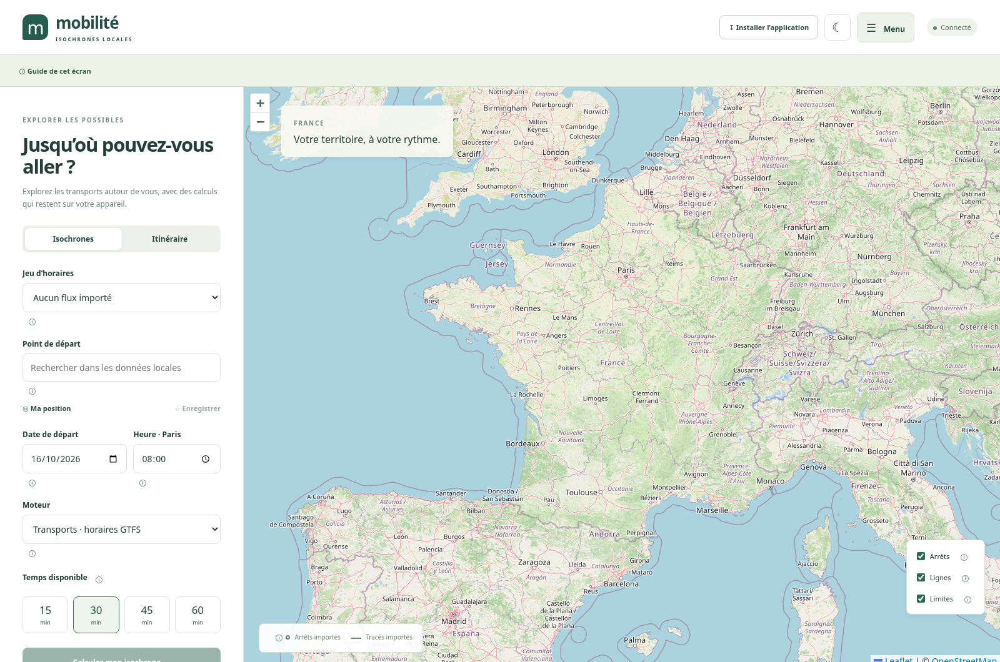
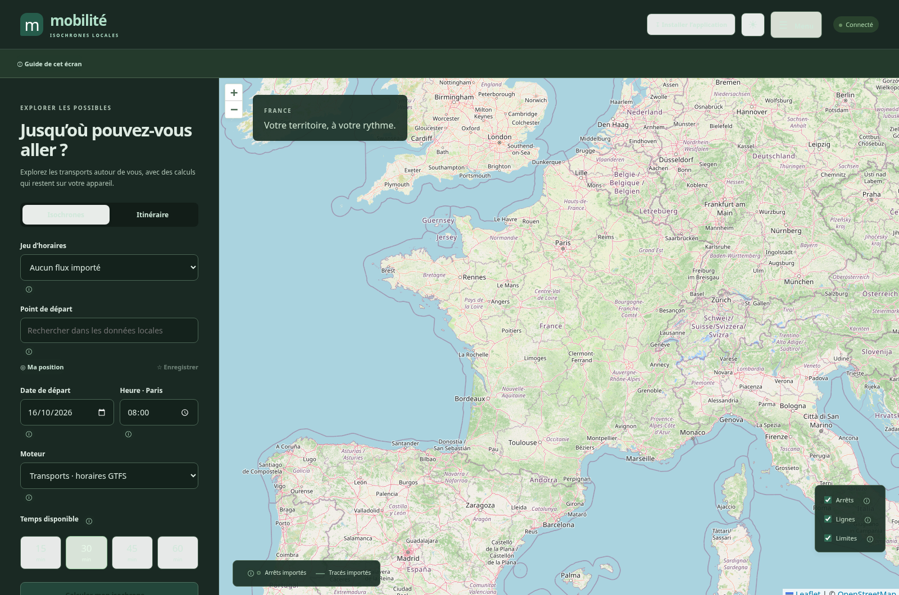
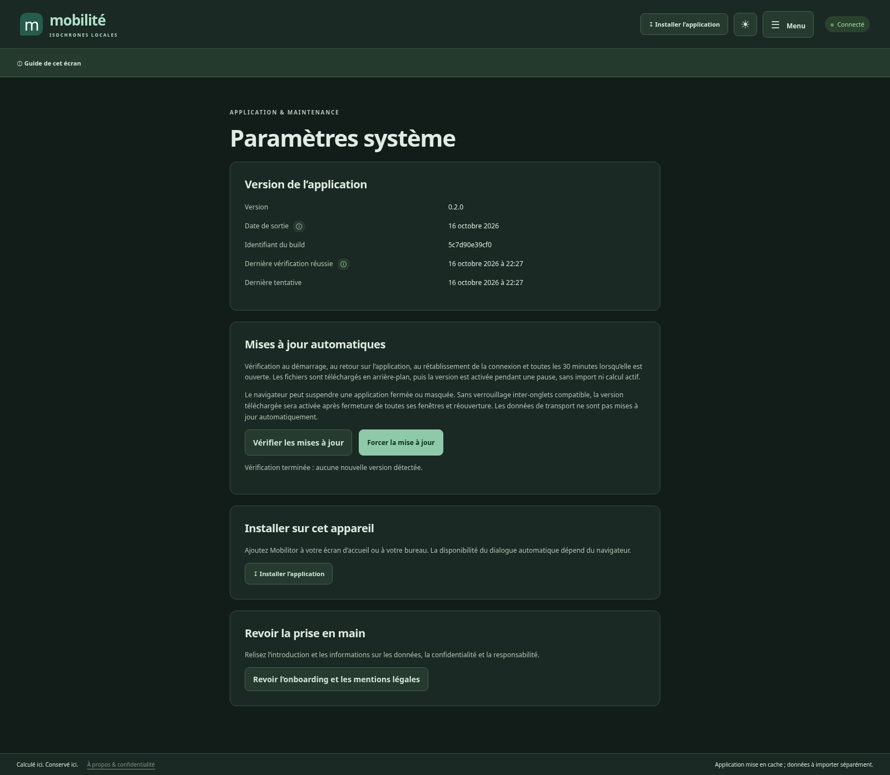

<p align="center">
  
</p>

# 🗺️ Mobilitor — Mobilité & isochrones locales

**Explorez la carte de France. Calculez vos déplacements en Île-de-France sur votre appareil.**


[](LICENSE)

PWA française sans compte ni serveur de calcul. Les données importées, favoris et scénarios restent dans **IndexedDB** ; les calculs s’exécutent dans des **Web Workers**. Aucun backend, PostgreSQL ou PostGIS requis.

[📸 Aperçu](#-aperçu) · [🚀 Démarrer](#-démarrer) · [📥 Importer](#-importer-et-calculer) · [📴 Hors ligne](#-utiliser-la-pwa-hors-ligne) · [📚 Documentation](#-documentation)

## 📸 Aperçu



_Capture réelle de la version 0.2.0, réalisée le 16 octobre 2026. Le fond OpenStreetMap est activé par défaut et nécessite Internet. Aucun jeu de transport n’est installé dans cet aperçu ; aucune station fictive n’est affichée._

> [!NOTE]
> La carte couvre la France métropolitaine, Corse comprise. Le moteur de transport vise les données GTFS compatibles importées pour l’Île-de-France : afficher la France ne signifie pas disposer d’horaires nationaux.

## ✨ Ce que permet l’application

|     | Fonctionnalité       | Fonctionnement                                                                                  |
| --- | -------------------- | ----------------------------------------------------------------------------------------------- |
| 🗺️  | Carte interactive    | OpenStreetMap par défaut, couches locales de stations, lignes et limites                        |
| 🔎  | Recherche et origine | Recherche locale, clic sur la carte ou géolocalisation facultative, puis choix d’un arrêt       |
| 🚉  | Itinéraires horaires | Routage GTFS local avec calendriers, exceptions, attente et correspondances prises en charge    |
| ⏱️  | Isochrones           | Arrêts atteignables à **15, 30, 45 et 60 minutes** ; disques symboliques autour des arrêts      |
| ⚖️  | Comparaison          | Deux ou trois origines du même flux, pour une date et une heure identiques                      |
| ⭐  | Favoris et scénarios | Enregistrement, réouverture des scénarios et suppression sur l’appareil                         |
| 📥  | Gestion des données  | Import CSV, GeoJSON et ZIP GTFS, validation, remplacement transactionnel, suivi du stockage     |
| 📤  | Exports              | Arrêts du seuil sélectionné en GeoJSON et carte locale en PNG, sans tuiles externes             |
| 📴  | PWA hors ligne       | Interface et calculs disponibles après mise en cache du shell et import des données nécessaires |

<details>
<summary><strong>Voir le thème sombre, le menu et les paramètres système</strong></summary>







</details>

## ☰ Menu, thèmes et prise en main

Le bouton **Menu** rassemble les fonctionnalités par catégorie :

| Catégorie               | Écrans                                              |
| ----------------------- | --------------------------------------------------- |
| Se déplacer             | Explorer (carte, isochrones, itinéraires), Comparer |
| Données et bibliothèque | Mes données, Sources                                |
| Application             | Paramètres, Système, À propos & mentions légales    |

- **Thème clair, sombre ou système** dans Paramètres ; raccourci clair/sombre dans l’en-tête. Le choix est conservé localement. Le fond OSM garde son style d’origine.
- **Onboarding en trois étapes** à la première ouverture et lors d’une nouvelle version de l’avis légal : présentation, données locales, puis provenance et limites de responsabilité. Le bouton final est activé après lecture signalée par une case ; ce choix est mémorisé sur l’appareil.
- **Guide contextuel pour chaque écran**, masquable et réouvrable avec « Guide de cet écran » ; les infobulles ⓘ des champs et de la carte se consultent au clic, au clavier ou au survol.
- **Installer l’application** dans l’en-tête, le menu et Système : dialogue natif lorsqu’il est proposé ; instructions iOS, Android et ordinateur sinon. Une demande acceptée ne constitue pas la confirmation de fin d’installation : celle-ci provient du navigateur.

## 🚀 Démarrer

**Prérequis : Node.js 22 et npm 10 ou plus.**

```bash
git clone https://github.com/nouhailler/mobilitor.git
cd mobilitor
npm install
npm run dev
```

Ouvrir l’URL locale affichée par Vite. Pour tester le Service Worker et le build statique :

```bash
npm run build
npm run preview
```

| Commande            | Utilité                                        |
| ------------------- | ---------------------------------------------- |
| `npm run dev`       | Développement avec Vite                        |
| `npm run test`      | Tests unitaires et d’intégration               |
| `npm run lint`      | Vérification ESLint                            |
| `npm run typecheck` | Vérification TypeScript                        |
| `npm run build`     | Génération des fichiers statiques dans `dist/` |
| `npm run preview`   | Aperçu local du build et de la PWA             |
| `npm run test:e2e`  | Parcours navigateur Playwright                 |

Pour Playwright : `npx playwright install chromium` ; ajouter `--with-deps` sur CI Linux. La PWA nécessite HTTPS en production ; `localhost` convient aux essais. Le Service Worker n’est pas activé dans le serveur de développement.

## 📥 Importer et calculer

1. Dans **Menu → Sources**, consulter la fiche officielle et la licence du fichier choisi.
2. Télécharger manuellement le fichier. Réduire les gros flux avec le [script facultatif de préparation](scripts/README.md).
3. Dans **Menu → Mes données**, sélectionner le fichier et renseigner producteur, licence et attribution. Choisir de conserver les jeux existants ou de remplacer une version.
4. Attendre la validation : le remplacement est transactionnel, sans suppression de l’ancienne version en cas d’échec.
5. Dans **Explorer**, choisir le flux, l’arrêt d’origine, la date et l’heure de Paris ; calculer une isochrone ou un itinéraire vers un autre arrêt.
6. Utiliser **Comparer** pour deux ou trois origines ; exporter les résultats ou enregistrer un scénario.

| Format        | Contenu accepté                                                                                  |
| ------------- | ------------------------------------------------------------------------------------------------ |
| CSV UTF-8     | Stations avec les colonnes `id,name,latitude,longitude`                                          |
| GeoJSON WGS84 | `FeatureCollection` de points, tracés ou limites administratives                                 |
| ZIP GTFS      | Horaires explicites du profil compatible ; détails dans le [guide d’import](docs/data-import.md) |

> [!TIP]
> Pour essayer sans données officielles, importer `data/fixtures/synthetic-gtfs.zip` : le **9 octobre 2026 à 08:00**, de **Test Alpha** à **Test Charlie**, l’arrivée attendue est **08:25**. Cette fixture synthétique n’est jamais chargée automatiquement.

## 📴 Utiliser la PWA hors ligne

- Héberger `dist/` sous HTTPS et ouvrir l’application en ligne jusqu’à la mise en cache du shell.
- Cliquer sur **Installer l’application** et suivre le dialogue ou le guide du navigateur. Sur iOS : Safari → **Partager → Sur l’écran d’accueil**.
- Importer un GTFS valide et les couches géographiques nécessaires. Vérifier la période de service et le stockage disponible.
- Dans **Paramètres**, demander si possible la persistance du stockage, puis tester en mode avion.

> [!IMPORTANT]
> Le fond OpenStreetMap nécessite Internet et ne fait l’objet d’aucun cache applicatif de tuiles. Hors ligne, seules les couches vectorielles importées s’affichent sur une grille neutre. Le navigateur peut refuser la persistance ou évincer les données : conserver les fichiers sources pour pouvoir les réimporter.

Le fond en ligne peut être désactivé dans **Paramètres**. Il transmet les demandes de tuiles et l’adresse IP au fournisseur ; les favoris et scénarios restent locaux. Voir la [confidentialité](docs/privacy.md) et la [stratégie hors ligne](docs/offline-mode.md).

## ↻ Paramètres système et mises à jour

**Menu → Système** affiche la version **0.2.0**, sa date de sortie (**16 octobre 2026**), l’identifiant du build, la dernière vérification réussie et la dernière tentative sur cet appareil. La date de vérification est enregistrée uniquement après un contrôle réussi ; un échec réseau ne la remplace pas. Elle concerne l’application, pas les données de transport.

| Action                    | Comportement                                                                                                                   |
| ------------------------- | ------------------------------------------------------------------------------------------------------------------------------ |
| Vérifier les mises à jour | Interroge le Service Worker avec contournement de son cache HTTP ; affiche le résultat ou l’erreur                             |
| Forcer la mise à jour     | Recherche une version et demande son activation si elle existe, sans effacer IndexedDB, favoris ni caches de données           |
| Vérification automatique  | Au démarrage, au retour sur l’application, au rétablissement de la connexion et toutes les 30 minutes tant qu’elle est ouverte |
| Installation automatique  | Télécharge les ressources en arrière-plan ; active et recharge lors d’une pause, sans import ou calcul actif                   |

Les opérations prennent un verrou partagé ; l’activation attend un verrou exclusif pour protéger aussi les autres onglets. Une saisie avec le focus et une interaction récente reportent l’activation automatique dans la fenêtre courante. Sans Web Locks, le téléchargement reste automatique, mais l’activation nécessite de fermer toutes les fenêtres de l’application puis de la rouvrir. Les données de transport ne sont jamais actualisées implicitement.

> [!NOTE]
> Le navigateur peut suspendre une PWA masquée ou fermée : aucune vérification périodique n’est garantie dans ce cas. Depuis la version 0.1, appliquer une première fois l’ancienne bannière de mise à jour ou fermer toutes les fenêtres puis rouvrir la PWA pour charger ce nouveau mécanisme. Aucun backend n’est ajouté.

## ⚖️ Données et responsabilité

Les mentions légales sont accessibles dans **À propos & mentions légales**, dans l’onboarding initial et depuis **Système → Revoir l’onboarding et les mentions légales**. Elles précisent que l’éditeur n’est pas le producteur des données tierces, n’en garantit pas l’exactitude et ne répond pas des erreurs ou conséquences de leur utilisation **dans les limites autorisées par la loi applicable**, sans exclure les responsabilités légalement impératives.

Le texte ne constitue pas une garantie d’exonération juridique. Les coordonnées légales de l’éditeur et de l’hébergeur restent à préciser pour une diffusion publique. Voir [les mentions et la confidentialité](docs/privacy.md).

## ⚙️ Capacités et limites

> [!WARNING]
> La marche, le temps réel, les fréquences GTFS et la couverture régionale exhaustive ne sont pas pris en charge. Les disques d’isochrone ne garantissent aucune accessibilité piétonne entre les arrêts.

<details>
<summary><strong>Afficher le profil GTFS, les limites de stockage et de cartographie</strong></summary>

- Connection Scan Algorithm, horaires explicites, calendriers hebdomadaires, exceptions, services du jour précédent et suivant, heures GTFS 00–47 h, correspondances explicites avec durée, interdictions simples de montée/descente.
- Pas de temps réel, fréquences, pathways, transport à la demande, correspondances garanties ou spécifiques à une course/ligne, contraintes d’accessibilité, optimisation multi-critères ou fusion entre plusieurs flux. Ces capacités sont refusées ou déclarées indisponibles.
- Fuseau Europe/Paris uniquement ; jours de changement d’heure refusés. L’origine et la destination sont des arrêts : un clic ou la géolocalisation exige ensuite de choisir un arrêt, sans inventer un accès à pied.
- Marche désactivée : pas d’import de réseau piéton routable dans cette version.
- Isochrones : arrêts atteignables à 15/30/45/60 min et disques **symboliques** de 80 m, sans prétendre rendre accessible toute leur surface. Pas d’enveloppe convexe trompeuse.
- Limites : fichier compressé 40 Mo, décompressé 250 Mo, 500 000 horaires. Import en Worker, validation en mémoire puis écriture par lots transactionnelle. Routage charge uniquement le flux sélectionné en Worker, avec calcul annulable. Prévoir approximativement **12 fois la taille compressée** libre ; dépend fortement du contenu. Les imports volumineux régionaux complets nécessitent une préparation, pas seulement une augmentation de quota.
- Carte : 1 500 stations maximum dans l’emprise, 500 tracés, 200 limites et 2 000 symboles d’isochrone par origine maximum. Les comptes et exports ne sont pas tronqués. Les shapes GTFS sont conservées pour provenance mais ne sont pas tracées ; importer les tracés en GeoJSON. Recherche locale limitée à 40 résultats.
- Scénarios enregistrés consultables, réouvrables et supprimables. Fond de carte et seuil par défaut persistés ; un seul moteur disponible.
- Téléchargement direct et import de fond hors ligne non implémentés. Import manuel sans proxy ; fond OSM en ligne activé par défaut, désactivable dans Paramètres, sans cache applicatif. La carte s’ouvre sur la France métropolitaine, Corse comprise.

</details>

Prévoir environ **12 fois la taille compressée du fichier** en espace libre, selon son contenu. Le flux régional complet doit être préparé en sous-réseaux compatibles ; une couverture exhaustive demandera une évolution des index et de l’import en flux.

## 🧪 Vérifications

Le [rapport de validation](docs/validation.md) distingue la validation initiale du 9 octobre et les contrôles de la version 0.2 du 16 octobre : moteur, imports, mises à jour, navigation, thème, onboarding et installation. **37 tests unitaires/intégration et 9 parcours Chromium passent pour la version 0.2.0**, ainsi que lint, TypeScript et build. Il distingue ces vérifications des essais encore nécessaires sur appareils Android/iOS. Les badges de ce README décrivent le projet ; ils ne constituent pas un statut de CI en temps réel.

## 🧱 Structure du dépôt

```text
src/
├── components/   # Carte, navigation, onboarding, installation et aides
├── db/           # IndexedDB, schéma Dexie et migrations
├── imports/      # CSV, GeoJSON, GTFS et validation
├── pages/        # Explorer, comparer, données, sources, paramètres
├── routing/      # Connection Scan Algorithm et géométrie
├── services/     # Services métier, mises à jour et verrous d’activité
├── styles/       # Interface responsive, thèmes clair/sombre
└── workers/      # Import et routage hors du fil principal
src/release.ts    # Version/date de sortie ; identifiant généré au build
docs/             # Guides, contexte technique associé et captures
public/           # Manifeste et icônes PWA
scripts/          # Préparation Python facultative, sans backend
data/fixtures/    # Petits jeux synthétiques de test
tests/            # Tests unitaires, intégration et navigateur
```

## 📚 Documentation

| Sujet                                       | Ressource                                                                                                |
| ------------------------------------------- | -------------------------------------------------------------------------------------------------------- |
| 🧭 Contexte du projet et reprise du travail | [CONTEXT.md](CONTEXT.md)                                                                                 |
| 🧱 Architecture et stockage                 | [Architecture](docs/architecture.md) · [Stockage local](docs/local-storage.md)                           |
| 📥 Données et provenance                    | [Sources](docs/data-sources.md) · [Import](docs/data-import.md) · [Préparation](scripts/README.md)       |
| 🚉 Moteurs                                  | [Routage GTFS](docs/gtfs-routing.md) · [Isochrones](docs/isochrone-engine.md)                            |
| 📱 Installation et hébergement              | [PWA](docs/pwa.md) · [Hors ligne](docs/offline-mode.md) · [Déploiement](docs/deployment.md)              |
| 🔒 Confidentialité et licences              | [Confidentialité](docs/privacy.md) · [Licences des données](docs/licensing.md)                           |
| 🧪 Qualité                                  | [Tests](docs/testing.md) · [Validation exécutée](docs/validation.md)                                     |
| 📝 Historique et contribution               | [CHANGELOG.md](CHANGELOG.md) · [CONTRIBUTING.md](CONTRIBUTING.md) · [Inventaire](docs/file-inventory.md) |

## ⚖️ Licence

Code sous [licence MIT](LICENSE). Fixtures synthétiques CC0. Les données publiques et les fonds cartographiques conservent leurs propres licences et obligations d’attribution ; aucun jeu officiel de transport n’est livré avec l’application.
