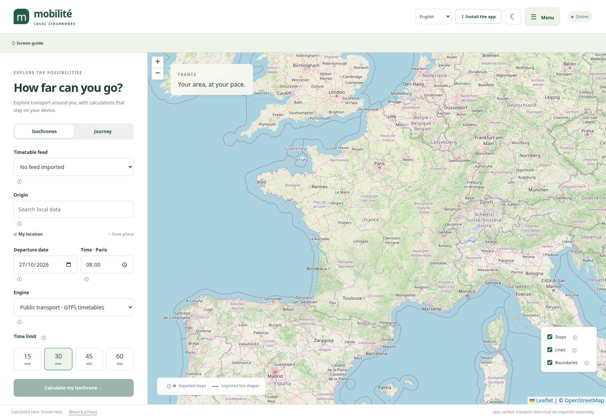

# Mobilitor in English

Mobilitor provides French and English interfaces. French remains the default for a new installation.

## Discover the app

The English overview is available at `/#/presentation/en`; the French version is at `/#/presentation/fr`. This page introduces the features, setup steps, privacy model and limitations without opening the app's onboarding. Select **Open the app** to start using Mobilitor. Existing app links remain unchanged.

## Choose English

Use the **Langue / Language** selector in the header, the language selector in the welcome dialog, or **Menu → Settings → Interface language**. Choose **English**. Your choice is saved in IndexedDB on this device and restored when you return, including offline.

To open the app in English explicitly, append `?lang=en` **before** the hash route, for example `/?lang=en#/systeme`. The path depends on where the app is hosted. Choosing French updates this parameter when present, so a reload does not override your selection.

Changing language does not reload the page or discard the current calculation and form fields. Maps, search, journeys, comparisons, imports, settings, update messages, onboarding, legal information, contextual guides and tooltips use local translations. Dates use British English formatting; departure times still refer to **Europe/Paris**.

## First journey

1. Read the welcome information and the limitations of third-party data. Select the acknowledgement checkbox to finish the guide.
2. Open **Menu → Sources** and check the official dataset page and the licence of the resource you intend to use.
3. Download a compatible dataset manually. Open **Menu → My data**, select the file and provide its producer, licence and attribution.
4. Open **Menu → Explore**. Choose the timetable feed, an origin stop, a date and a Paris departure time. Select **Journey** for a destination, or calculate an isochrone.
5. Compare two or three origins, export results, save a place or save a scenario.

For a synthetic test, import `data/fixtures/synthetic-gtfs.zip`. On **9 October 2026 at 08:00**, a journey from **Test Alpha** to **Test Charlie** arrives at **08:25**. These are test fixtures, not official transport data, and are never loaded automatically.

## What does not change with the language

Station and line names, GTFS identifiers, imported files, attribution, saved places and existing scenario names are not rewritten or machine-translated. The transport engine and supported GTFS profile are the same in both interfaces. An English map does not add national timetable coverage.

The online OpenStreetMap basemap requires an internet connection. Local calculations require an imported, valid GTFS feed. Walking, GTFS frequencies, real-time information and daylight saving transition days are not supported. Large feeds must be reduced to a compatible subnetwork: maximum 40 MB compressed and 500,000 stop times. Isochrone discs are symbolic, not evidence of walking access.

The English web manifest and translation catalogue are precached with the app. Installation dialogs and native date/file controls remain under the browser's control and may use its own language. App updates do not update transport datasets automatically.

## Technical reference

- `src/i18n/en.json`: English catalogue keyed by the original French interface text.
- `src/i18n/index.ts`: language state, persistence, date locale, document metadata and known dynamic messages.
- `src/i18n/useLocale.ts`: React subscriptions without remounting screens.
- `public/manifest.en.webmanifest`: English installation metadata, sharing the app identity and storage origin with the French manifest.
- `tests/unit/i18n.test.ts` and `tests/e2e/english.spec.ts`: language switching, persistence, identifiers, legal onboarding, imports, errors, journeys and offline use.

Translations are bundled locally; no remote translation service is contacted. Routes remain unchanged for compatibility with existing links. Unknown technical diagnostics are displayed as received rather than being replaced by an invented translation.
